  
  
  
  
  
  

 

### 01 &nbsp;/&nbsp; About

I'm a university student who likes turning ideas into things people can actually use: mobile apps, games, stock-analysis tools and developer utilities. Most of my projects start as *"wouldn't it be cool if…"* and end up teaching me a new language or framework along the way.

 

### 02 &nbsp;/&nbsp; Now

**Building** &nbsp;—&nbsp; Web apps with TypeScript & React, games in Unity and Godot 
**Exploring** &nbsp;—&nbsp; AI tooling and MCP servers that plug LLMs into real software 
**Learning** &nbsp;—&nbsp; Game networking and desktop tooling

 

### 03 &nbsp;/&nbsp; Stack

**Languages** &nbsp;—&nbsp; TypeScript · JavaScript · Dart · C# · Python · Java · C 
**Frameworks** &nbsp;—&nbsp; React · Next.js · Flutter · Node.js · Tailwind CSS 
**Game engines** &nbsp;—&nbsp; Unity · Godot 
**Data & infra** &nbsp;—&nbsp; PostgreSQL · Supabase · Firebase · Vercel 
**Tools** &nbsp;—&nbsp; Git · VS Code · Figma

 

### 04 &nbsp;/&nbsp; Selected work

  
<b>Screenshot-Enhancer</b> &nbsp;—&nbsp; macOS-style screenshot preview for Windows

   

  A floating thumbnail you can drag and drop into any app. Comes with OCR, region capture and works fully offline.

    
    

  
<b>More on the way</b> &nbsp;—&nbsp; apps, games and tools currently in private development

   

  Most of what I'm working on is still private while it takes shape. Check the [portfolio](https://aydinenesdev.vercel.app/) for the latest.
    

 

### 05 &nbsp;/&nbsp; Activity

    
    
  

 

 

